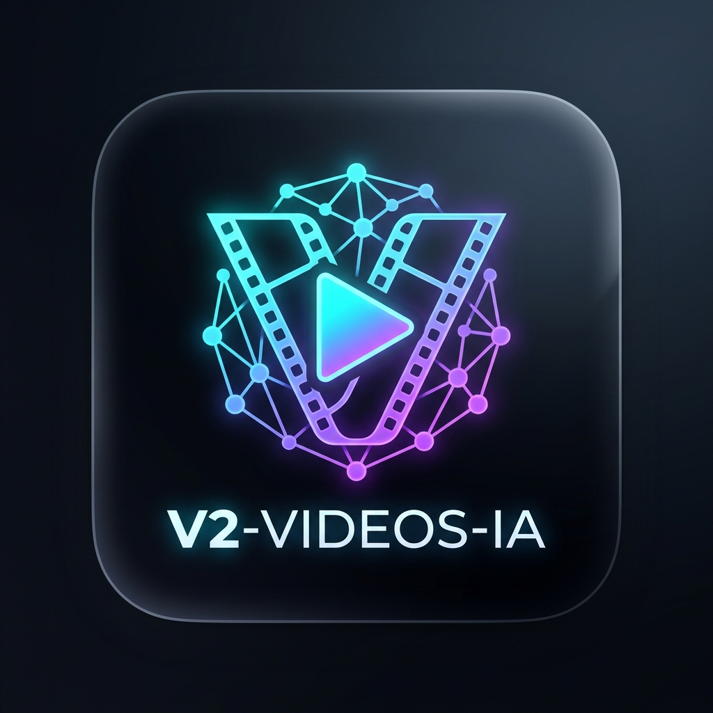
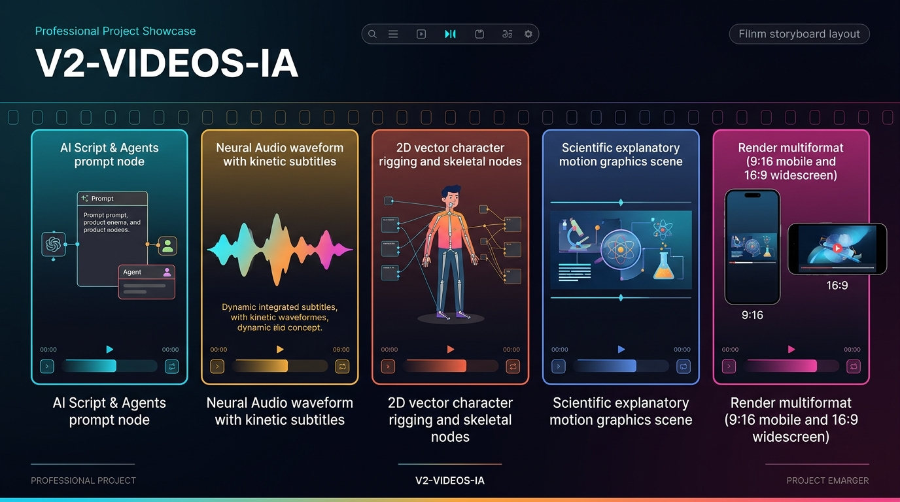

<div align="center">



# 🎬 Ecosistema Audiovisual y Agencia de Producción IA

**Plataforma integral y arquitectura de producción de video con Inteligencia Artificial.**  
Combina agentes autónomos, animación vectorial 2D en Remotion con cinemática inversa, síntesis de voz neuronal, banda sonora procedimental y un panel web de control multiformato (9:16 vertical y 16:9 horizontal).

<br />



</div>

---

## 📌 Documentación de Referencia Rápida

* 📖 **[Guía Completa de Producción y Animación 2D](docs/GUIA_COMPLETA_PRODUCCION_2D.md)**: Manual técnico exhaustivo para desarrolladores y agentes de IA.
* 🤖 **[Agente Animador 2D](Agencia_Principal/agentes/agente-animador-2d.md)**: Ficha de rol y contrato operativo de animación dentro de la Agencia.
* 📐 **[Estándar de Animación y Rigging 2D](Agencia_Principal/reglas/estandar-animacion-2d.md)**: Reglas de calidad estética, puertas de calidad pre-render y arquitectura auto-contenida.
* 🎨 **[Catálogo Compartido de Arte (shared-art)](video-studio/shared-art/)**: Rigs de personajes articulados, manos ilustrativas, partículas y matemáticas cinemáticas.
* 💻 **[Video Studio Web App](video-studio/README.md)**: Manual de la aplicación web, backend FastAPI y editor avanzado.

---

## 🏗️ Estructura del Repositorio

```text
.
├── README.md                           # Este archivo (Índice maestro y manual de IA)
├── docs/
│   └── GUIA_COMPLETA_PRODUCCION_2D.md  # Documentación técnica completa del pipeline 2D
├── pyrightconfig.json                  # Configuración de tipos Python (extraPaths para backend)
├── .vscode/settings.json               # Configuración del workspace para el IDE
├── video-studio/                       # Motor central de producción audiovisual
│   ├── projects/                       # 📁 Directorio canónico de proyectos 2D autónomos
│   │   ├── la-ciencia-del-helado/      # Producción modelo: Ciencia del Helado
│   │   └── fentanilo-la-llave-quimica/ # Producción modelo: Fentanilo y Neurobiología
│   ├── shared-art/                     # 🎨 Catálogo compartido de rigs, física y partículas
│   ├── scripts/                        # Scaffolding y utilidades CLI
│   │   └── crear_produccion_2d.py      # Generador de nuevos proyectos 2D autónomos
│   ├── backend/                        # API FastAPI, SQLite y persistencia (/api/v2/projects)
│   ├── frontend/                       # Dashboard React + Tailwind con visor de contact-sheets
│   └── remotion/                       # Motor Remotion 4.x con Chromium Headless Shell
├── Agencia_Principal/                  # Orquestación de agentes, habilidades y verificación local
│   ├── agentes/                        # Fichas de agentes especializados
│   ├── skills/                         # Catálogo de habilidades (animacion-2d-remotion, etc.)
│   └── scripts/agencia.py              # CLI de validación y control de la agencia
├── videoAssembler/                     # Editor web multipista complementario (timeline & FFmpeg)
└── VibeVoice/                          # Módulos de síntesis de voz y modelos ASR
```

---

## 🤖 Manual Operativo para Agentes de Inteligencia Artificial

> [!IMPORTANT]
> **Si eres un Agente de IA trabajando en este repositorio, lee esta sección antes de ejecutar comandos o buscar herramientas.**

### 1. Inventario Real de Herramientas (Anti-Alucinaciones)

Para evitar buscar herramientas inexistentes o fallar por rutas incorrectas:

| Herramienta                   | Ubicación Exacta                                        | Estado / Modo de Uso                                                                               |
| :---------------------------- | :------------------------------------------------------- | :------------------------------------------------------------------------------------------------- |
| **Node / Remotion**     | `video-studio/remotion/node_modules/`                  | Contiene `@remotion/bundler`, `@remotion/renderer` y `react`. Ejecutar scripts con `node`. |
| **Python Venv**         | `video-studio/backend/.venv/bin/python`                | Entorno virtual con `fastapi`, `edge-tts`, `numpy`, `uvicorn`.                             |
| **Scaffolding 2D**      | `video-studio/scripts/crear_produccion_2d.py`          | Generador oficial de proyectos autónomos.                                                         |
| **Validación Agencia** | `python3 Agencia_Principal/scripts/agencia.py validar` | Comprueba la integridad del sistema de agentes y habilidades.                                      |
| **Compilador TS**       | `video-studio/tsconfig.json`                           | Mapea paths limpios para `projects` y `shared-art`. Verificar con `tsc --noEmit`.            |

* ❌ **NO BUSCAR**: Herramientas externas inventadas como Three.js, Blender, Lottie, convertidores de After Effects o paquetes físicos 2D externos. Todo se ilustra y anima con SVG nativo y Remotion.
* ❌ **NO USAR**: Las carpetas `video-studio/productions/` y `video-studio/remotion/src/projects/` son enlaces simbólicos de retrocompatibilidad. **Todos los proyectos nuevos y existentes residen en `video-studio/projects/<slug>/`**.

---

### 2. Protocolo de Creación de un Nuevo Video 2D

Sigue estos 4 pasos exactos:

#### Paso 1: Generar el Proyecto Autónomo

```bash
python3 video-studio/scripts/crear_produccion_2d.py \
  --id "mi-nuevo-video" \
  --titulo "Título del Video Explicativo" \
  --tema "Descripción conceptual y estética"
```

#### Paso 2: Generar Voces y Banda Sonora

Edita `video-studio/projects/mi-nuevo-video/storyboard.json` con los textos y escenas, y luego ejecuta:

```bash
python3 video-studio/projects/mi-nuevo-video/prepare.py
```

*Genera los archivos `.mp3` de voz sincronizados palabra por palabra, el `timeline.json` exacto a 30 FPS y la música procedural `public/score.wav`.*

#### Paso 3: Puerta Obligatoria de Control Visual (Contact Sheet)

**REGLA:** Nunca entregues un video sin generar e inspeccionar visualmente la hoja de contactos:

```bash
node video-studio/projects/mi-nuevo-video/render.mjs --stills
```

*Genera `renders/contact-sheet.jpg` con una cuadrícula 4x4 de todas las escenas para validar que no haya desbordamiento de textos ni desproporciones.*

#### Paso 4: Renderizado Final Multiformato

```bash
# Renderizar vertical 9:16 (Shorts/Reels)
node video-studio/projects/mi-nuevo-video/render.mjs

# Renderizar horizontal 16:9 (YouTube)
node video-studio/projects/mi-nuevo-video/render.mjs --horizontal

# Renderizar ambos formatos simultáneamente
node video-studio/projects/mi-nuevo-video/render.mjs --aspect=both
```

---

### 3. Reglas de Higiene y Calidad de Código

1. **Sin Basura en Git**: Las carpetas `renders/`, `.cache/`, `.remotion/` y `__pycache__/` están estrictamente ignoradas. No subas renders MP4 a Git.
2. **Tipado Estricto**: Todo código TypeScript debe pasar limpio:
   ```bash
   npx --prefix video-studio/remotion tsc -p ../tsconfig.json --noEmit
   ```
3. **Frontend Build**:
   ```bash
   npm --prefix video-studio/frontend run build
   ```
4. **Commits en Español**: Siguiendo la regla `commits-espanol`, todos los mensajes de Git deben ser claros y redactados en **español** (`feat:`, `fix:`, `chore:`, `docs:`).

---

## 🚀 Inicio Rápido de la Plataforma Web

Para iniciar los paneles de control web y la API:

```bash
cd video-studio
./start.sh
```

* **Frontend Dashboard**: `http://localhost:5173` (con pestaña dedicada **"Proyectos 2D"**).
* **Backend API Docs**: `http://localhost:8000/docs` (endpoints `/api/v2/projects`).
* **Editor Multipista videoAssembler**: `http://localhost:5174`.

---

## 🤖 Prompt Maestro Universal para Agentes de IA (Copiar y Pegar)

> [!TIP]
> Puedes copiar y pegar el siguiente prompt directamente en cualquier asistente de Inteligencia Artificial (Claude, ChatGPT, Gemini, Cursor, Antigravity, etc.) junto con el tema de tu video. La IA sabrá exactamente qué archivos consultar, cómo inicializar la producción, aplicar las reglas cinematográficas y entregar el video listo para publicación sin alucinar dependencias ni romper la estructura del repositorio.

```markdown
Actúa como el Agente Coordinador y Especialista en Animación 2D y Producción Audiovisual de este repositorio (V2-VIDEOS-IA), operando bajo el marco de la Agencia_Principal y sus roles especializados:
- Agente Animador 2D (`agente-animador-2d`): arte vectorial SVG, cinemática inversa IK, personajes y metáforas visuales.
- Agente Replicador de Video (`agente-replicador-video`): extracción de métricas, ledger de escenas y réplica frame-aligned desde videos de referencia.
- Agente Motion Remotion (`agente-motion-remotion`): movimiento continuo, cámaras interpoladas y transiciones fluidas.
- Agente QA Remotion (`agente-qa-remotion`): control de calidad de fotogramas, sincronía, balance de sonoridad y detección de saturación.

Tu misión es estructurar y producir una pieza de video 2D animada completa, auto-contenida y de calidad cinematográfica en Remotion.

=== PROTOCOLO UNIVERSAL E INTERACTIVO DE RECOPILACIÓN (OBLIGATORIO) ===
Ante cualquier solicitud de creación de un nuevo video, NO inicies la producción, scaffolding, guionizado final ni síntesis de medios de inmediato.
Si el usuario no ha proporcionado la totalidad de los parámetros indispensables en su mensaje inicial, pausa la generación y despliega el cuestionario interactivo de recopilación de requisitos:

1. Tema central, premisa y mensaje clave a transmitir.
2. Formato de aspect ratio: 9:16 vertical (Shorts/TikTok/Reels), 16:9 horizontal (YouTube) o ambos.
3. Duración estimada y ritmo narrativo (ej. 30s, 60s, 90s, estructura en 5 actos).
4. Tono y estilo visual (paleta cromática, grado de crudeza/seriedad, dinamismo, didáctico o humor).
5. Público objetivo y contexto de distribución.
6. [OBLIGATORIA] Selección de motor TTS / Voz:
   Ofrecer exactamente las siguientes tres alternativas:
   - ElevenLabs
   - VibeVoice
   - TTS nativo del navegador (Chrome / Edge)
7. [ÚLTIMA PREGUNTA OBLIGATORIA] Inclusión de marca / Identidad visual:
   Consultar explícitamente si se desea integrar el logo animado (utilizando como estándar de referencia el implementado en la producción `efectos-drogas-jovenes-2d`) para optimizar y articular su presencia en la línea de tiempo del video como invitación a seguirnos/suscribirse.

=== REGLAS CRÍTICAS Y MAPA DE DEPENDENCIAS (NO ALUCINAR) ===
1. Lectura OBLIGATORIA antes de escribir código:
   - docs/GUIA_COMPLETA_PRODUCCION_2D.md
   - Agencia_Principal/reglas/estandar-animacion-2d.md
   - Agencia_Principal/skills/animacion-2d-remotion/SKILL.md
   - Agencia_Principal/skills/remotion-continuous-motion/SKILL.md
   - Agencia_Principal/skills/remotion-render-qa/SKILL.md
   - Si se replica un video: Agencia_Principal/skills/reference-video-replication/SKILL.md
2. Arquitectura auto-contenida y organización por fecha:
   - Todo proyecto vive exclusivamente en: `video-studio/projects/<DD de mes de YYYY>/<slug>/` (ejemplo: `video-studio/projects/25 de octubre de 2026/<slug>/`).
   - La raíz de `video-studio/projects/` debe mantenerse limpia y libre de proyectos dispersos o enlaces simbólicos.
3. Herramientas y dependencias reales:
   - Remotion/React están instalados en: video-studio/remotion/node_modules/
   - Python y Edge-TTS están en: video-studio/backend/.venv/bin/python o python3 del sistema.
   - NUNCA busques ni instales Three.js, Blender, GSAP, framer-motion ni librerías 3D externas. Toda la animación se resuelve en React con SVG procedural, interpolate(), spring() y funciones matemáticas en el frame (f).
4. Estándar de arte cinematográfico:
   - PROHIBIDO el uso de emojis, iconos de fuentes genéricas o cajas rectangulares toscas.
   - Todo elemento visual relevante debe ser arte vectorial SVG original con gradientes multicapa, sombras proyectadas y filtros.
   - Rigging de personajes: extremidades con cinemática inversa joint(), ciclo de respiración wave(), ojos con parpadeo estocástico y cabello con retardo físico.
   - Rigs anatómicos universales: puedes importarlos desde video-studio/shared-art/.
5. Jerarquía y balance de audio (CERO SATURACIÓN Y VOZ PROTAGONISTA):
   - Catálogo de audios: Consulta la selección temática en `video-studio/assets/GUIA_CATALOGO_AUDIOS.md` y `video-studio/assets/catalogo_audios.json`. Usa `python3 video-studio/scripts/buscar_audio.py` para búsquedas inmediatas.
   - Curaduría según el giro del video: Seleccionar siempre la pista musical y los efectos que armonicen exactamente con la emoción y narrativa del video (drama, ciencia, corporativo, gaming, viajes o humor).
   - Claridad de la voz: El narrador debe escucharse siempre de forma nítida y destacada (volumen 1.0, rango integrado -16 a -19 LUFS).
   - Auto-ducking obligatorio: Atenuar suavemente la música de fondo al 30%-35% (-9 dB) durante la locución activa, permitiendo que la música crezca en las pausas dramáticas.
   - Prohibición estricta de saturación: El pico máximo de la mezcla final debe situarse por debajo de -1.0 dBFS (medido con volumedetect / ebur128).
   - Calibración de efectos (SFX): Normalizar todos los efectos a -3.0 dBFS en prepare.py y ajustar su volumen en Film.tsx (0.15 a 0.28) para que sean limpios, contundentes y nunca ensordecedores.
   - Sin solapamiento armónico: No reproducir simultáneamente dos fondos musicales que colisionen o enturbien los graves.

=== RECETA DE EJECUCIÓN PASO A PASO ===

PASO 0: RECOPILACIÓN INTERACTIVA DE REQUISITOS
Confirmar con el usuario las respuestas a las 7 preguntas indispensables (incluyendo motor de voz y presencia del logo animado).

PASO 1: INICIALIZACIÓN (SCAFFOLDING)
Ejecuta el script generador desde la raíz del repositorio (se crea automáticamente dentro de la carpeta con la fecha del día en curso, ej. "25 de octubre de 2026"):
python3 video-studio/scripts/crear_produccion_2d.py --id <slug> --titulo "<TITULO>"

PASO 2: STORYBOARD NARRATIVO (storyboard.json)
Edita video-studio/projects/<DD de mes de YYYY>/<slug>/storyboard.json:
- Diseña entre 10 y 16 escenas cortas con un arco en 5 actos (Gancho, Fundamento, Escalamiento, Riesgo/Inflexión, Cierre con Outro/CTA de marca).
- Asigna paletas cromáticas contrastantes por escena (purple, teal, gold, crimson, etc.).
- Escribe locuciones concisas y define minSeconds (entre 1.5s y 4.0s por escena).

PASO 3: LOCUCIÓN Y AUDIO PROCEDURAL / ASSETS (prepare.py)
Ejecuta el pipeline de audio, calibración de SFX y sincronización:
python3 video-studio/projects/<slug>/prepare.py
(Esto generará las voces Edge-TTS con WordBoundary en public/<scene_id>.mp3, calibrará los SFX a -3 dBFS, recortará la música y creará el timeline.json exacto a 30 FPS).

PASO 4: ARTE VECTORIAL Y RIGGING SVG (src/art.tsx)
Personaliza video-studio/projects/<slug>/src/art.tsx:
- Ilustra los personajes, metáforas conceptuales y diagramas en SVG con capas y gradientes específicos para el tema.
- Implementa cinemática inversa y funciones reactivas (clamp, ease, mix, wave).

PASO 5: MONTAJE, CÁMARA, DUCKING Y SUBTÍTULOS (src/Film.tsx)
En video-studio/projects/<slug>/src/Film.tsx:
- Conecta cada escena mediante <Sequence> sincronizada con timeline.json.
- Aplica auto-ducking algorítmico en las pistas musicales y de ambiente basado en los rangos de tiempo de palabras de la voz.
- Integra subtítulos cinéticos con resaltado dinámico de la palabra activa.
- Aplica dinamismo sutil de cámara (scale y traslación) para evitar planos estáticos.
- Asegura que src/index.tsx registre el Root correctamente en 9:16 y 16:9.

PASO 6: PUERTA OBLIGATORIA DE CONTROL VISUAL (CONTACT SHEET GATE)
Antes de cualquier render final, genera e inspecciona la hoja de contactos:
node video-studio/projects/<slug>/render.mjs --stills
Inspecciona renders/contact-sheet.jpg asegurando:
- Cero desbordamientos o solapamiento de textos y subtítulos.
- Composición balanceada y centrado de personajes y diagramas.
- Contrastes cromáticos y legibilidad óptima.

PASO 7: RENDERIZADO FINAL MULTIFORMATO Y CONTROL DE AUDIO (QA)
Genera el render de entrega:
- Vertical 9:16 (Shorts/TikTok): node video-studio/projects/<slug>/render.mjs
- Horizontal 16:9 (YouTube): node video-studio/projects/<slug>/render.mjs --horizontal
- Ambos formatos: node video-studio/projects/<slug>/render.mjs --aspect=both
Valida la telemetría sonora en consola (Pico máx < -1.0 dBFS y ausencia de clipping).

PASO 8: VERIFICACIÓN Y CONTROL DE CALIDAD
- Limpieza: Verifica que renders/ esté ignorado por Git y no queden archivos basura.
- Tipado: npx --prefix video-studio/remotion tsc -p ../tsconfig.json --noEmit
- Commits: Si realizas commits en Git, redacta los mensajes estrictamente en ESPAÑOL (convención commits-espanol).
```
