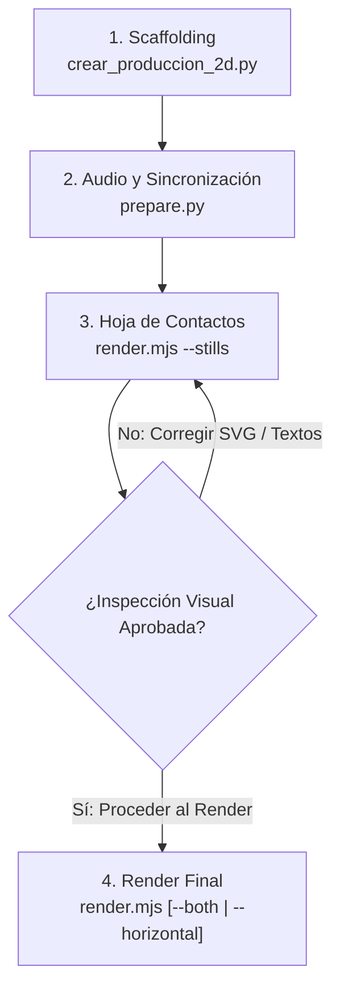

# Guía Completa de Producción y Animación 2D Autónoma en Video Studio IA

> [!IMPORTANT]
> **Lectura obligatoria para desarrolladores y Agentes de Inteligencia Artificial.**  
> Esta guía establece el estándar técnico, operativo y visual de las producciones animadas 2D. Todos los proyectos deben ser **100% auto-contenidos**, con soporte **multiformato (9:16 vertical y 16:9 horizontal)**, **cero dependencias de herramientas ficticias** y control de calidad visual previo al render final.

---

## 1. Arquitectura de Repositorio y Mapa de Herramientas

Para evitar búsquedas infructuosas o alucinaciones de herramientas inexistentes, este es el inventario real y operativo del ecosistema:

```
/mnt/nvme/V2-VIDEOS-IA/
├── README.md                           # Índice maestro del repositorio
├── docs/                               # Documentación técnica de referencia
│   └── GUIA_COMPLETA_PRODUCCION_2D.md  # Esta guía
├── pyrightconfig.json                  # Resolución de tipos Python para IDE y Pyright
├── .vscode/settings.json               # Configuración del entorno de desarrollo
├── video-studio/                       # Motor central de producción audiovisual
│   ├── projects/                       # 📁 Directorio canónico de proyectos 2D autónomos
│   │   ├── la-ciencia-del-helado/      # Proyecto modelo A (química y alimentos)
│   │   └── fentanilo-la-llave-quimica/ # Proyecto modelo B (biología y medicina)
│   ├── shared-art/                     # 🎨 Catálogo compartido de arte, rigs y matemáticas
│   │   ├── math/motion.ts              # Interpolaciones y cinemática inversa (IK)
│   │   ├── rigs/CharacterRig.tsx       # Personaje articulado con parpadeo y emociones
│   │   ├── rigs/Hands.tsx              # Manos explicativas vectoriales
│   │   ├── effects/Particles.tsx       # Chispas, polvo flotante y auras de energía
│   │   └── components/KineticLabels.tsx# Badges y métricas animadas
│   ├── scripts/
│   │   └── crear_produccion_2d.py      # CLI generador de proyectos 2D autónomos
│   ├── backend/                        # API FastAPI, orquestador y persistencia
│   │   ├── .venv/                      # Entorno virtual Python (usar: backend/.venv/bin/python)
│   │   └── main.py                     # API con endpoints /api/v2/projects
│   ├── frontend/                       # Dashboard web en React + Tailwind + Vite
│   │   └── src/components/
│   │       ├── ProjectDashboard.tsx    # Panel visual de control de proyectos 2D
│   │       └── VideoPlayerModal.tsx    # Reproductor adaptativo (9:16 y 16:9)
│   └── remotion/                       # Motor Remotion 4.x
│       └── node_modules/               # Dependencias de Remotion, React y Bundler
├── Agencia_Principal/                  # Sistema de agentes, reglas y habilidades
│   ├── agentes/agente-animador-2d.md   # Ficha operativa del agente animador
│   └── reglas/estandar-animacion-2d.md # Reglas de calidad estética y arquitectónica
└── videoAssembler/                     # Editor web multipista complementario (timeline)
```

### ⚠️ Herramientas Existentes vs. Inexistentes (Anti-Hallucination)

* ✅ **SÍ EXISTE**: `node_modules` en `video-studio/remotion/node_modules/` (incluye `@remotion/bundler`, `@remotion/renderer`, `react`, etc.).
* ✅ **SÍ EXISTE**: Python venv en `video-studio/backend/.venv/` (con `edge-tts`, `numpy`, `fastapi`, `pydantic`).
* ✅ **SÍ EXISTE**: Motor Remotion 4.x con Chromium Headless Shell integrado.
* ✅ **SÍ EXISTE**: Scaffolding CLI `python3 video-studio/scripts/crear_produccion_2d.py`.
* ❌ **NO EXISTE / NO BUSCAR**: No busques Three.js, Blender, After Effects, Lottie, paquetes de física Box2D o herramientas CLI externas inventadas.
* ❌ **NO BUSCAR**: No busques `productions/` ni `remotion/src/projects/` para almacenar código; son enlaces simbólicos de retrocompatibilidad. Toda producción vive en `video-studio/projects/<slug>/`.

---

## 2. Anatomía de un Proyecto 2D Auto-Contenido

Cada video es un ecosistema cerrado ubicado en `video-studio/projects/<slug>/`. No requiere registrarse manualmente en la raíz de Remotion ni alterar la configuración global del estudio.

```
video-studio/projects/<slug>/
├── project.json            # Metadatos descriptivos (título, versión, autor, temas)
├── storyboard.json         # Guion narrativo escena por escena, capítulos y paletas
├── timeline.json           # Timestamps calculados en frames a 30 FPS con marcas por palabra
├── prepare.py              # Script de generación de locución TTS y banda sonora procedimental
├── render.mjs              # Script autónomo de renderizado (Full HD, borrador y contact sheet)
├── tsconfig.json           # Configuración TypeScript apuntando a node_modules de remotion
├── package.json            # Declaración de compatibilidad Remotion
├── src/
│   ├── index.tsx           # Entrypoint autónomo con composiciones 9:16 y 16:9
│   ├── Film.tsx            # Montaje React: secuencias, cámara, audio y subtítulos cinéticos
│   ├── art.tsx             # Biblioteca de arte vectorial SVG local del proyecto
│   └── timeline.json       # Enlace local para importación directa en el bundler
├── public/
│   ├── <scene_id>.mp3      # Locuciones individuales por escena generadas por Edge-TTS
│   ├── score.wav           # Banda sonora musical procedimental estéreo a 32 kHz
│   └── UbuntuSans.ttf      # Tipografía tipográfica vectorial empaquetada
└── renders/                # Salidas de render (IGNORADAS EN GIT)
    ├── contact-sheet.jpg   # Mosaico de control de calidad (4x4) de todas las escenas
    ├── stills/             # Capturas PNG individuales fotograma a fotograma
    ├── preview-720p.mp4    # Borrador rápido vertical (720x1280)
    ├── preview-16x9-720p.mp4# Borrador rápido horizontal (1280x720)
    ├── master-1080p.mp4    # Video master Full HD vertical (1080x1920, CRF 17)
    └── master-16x9-1080p.mp4# Video master Full HD horizontal (1920x1080, CRF 17)
```

---

## 3. Flujo Operativo Paso a Paso (La Receta Canónica)

Cualquier agente de IA o desarrollador debe seguir estrictamente estas cuatro fases:



### Paso 1: Crear el Scaffolding del Proyecto

Ejecuta el script generador desde la raíz del repositorio:

```bash
python3 video-studio/scripts/crear_produccion_2d.py \
  --id "el-origen-del-cafe" \
  --titulo "El Origen Secreto del Café" \
  --tema "Botánica, moléculas de cafeína, historia y tostado artesanal"
```

Esto generará automáticamente la carpeta `video-studio/projects/el-origen-del-cafe/` con todos sus archivos listos, plantillas de escenas, rigging y scripts ejecutables.

### Paso 2: Generar Voces y Sincronización (`prepare.py`)

Abre `storyboard.json` y personaliza los textos y capítulos. Luego, genera los audios y la banda sonora:

```bash
cd video-studio/projects/el-origen-del-cafe
python3 prepare.py
```

* **Qué hace**:
  1. Invoca Microsoft Edge-TTS con marcas de tiempo precisas palabra por palabra (`WordBoundary`).
  2. Calcula la duración real de cada escena en frames exactos a 30 FPS (`timeline.json`).
  3. Sintetiza una banda sonora armónica y dinámica procedural en `public/score.wav`.

### Paso 3: Puerta Obligatoria de Control de Calidad (`contact-sheet.jpg`)

**REGLA CRÍTICA**: Nunca lances un render final sin generar e inspeccionar primero la hoja de contactos:

```bash
node render.mjs --stills
```

* **Qué hace**:
  1. Renderiza un fotograma representativo (still PNG) de cada escena en `renders/stills/`.
  2. Invoca FFmpeg para componer un mosaico cuadrangular de alta resolución en `renders/contact-sheet.jpg`.
  3. Te permite inspeccionar visualmente en una sola imagen si hay solapamiento de textos, errores de centrado o desproporciones anatómicas.

### Paso 4: Renderizado Multiformato (9:16 y 16:9)

Una vez aprobada la hoja de contactos, ejecuta el renderizado según el formato deseado:

```bash
# Opción A: Renderizar versión vertical 9:16 (Shorts / Reels / TikTok)
node render.mjs

# Opción B: Renderizar versión horizontal 16:9 (YouTube estándar)
node render.mjs --horizontal

# Opción C: Renderizar ambas versiones simultáneamente (Master 1080p)
node render.mjs --aspect=both

# Opción D: Borrador rápido de validación (720p en pocos segundos)
node render.mjs --draft
node render.mjs --horizontal --draft
```

---

## 4. Estándar de Ilustración Vectorial y Rigging 2D

### Principios Visuales Inquebrantables
1. **Arte Vectorial Puro (Zero Placeholders)**: Todo elemento debe dibujarse en SVG enriquecido con gradientes (`linearGradient`, `radialGradient`), filtros de desenfoque (`feGaussianBlur`) y sombras proyectadas (`filter="drop-shadow(...)"`).
2. **Prohibición de Emojis e Iconos Planos**: Nunca utilices emojis Unicode ni fuentes de iconos genéricos (como FontAwesome o Lucide plano) dentro del lienzo del video; todo debe ser arte vectorial propio.
3. **Rigging Articulado con Cinemática Inversa (IK)**:
   * Extremidades en 2 segmentos unidas por el solver `joint(a, b, l1, l2, bend)`.
   * Respiración sutil en el torso: `scale(1, 1 + wave(f, 0.075, 0.009))`.
   * Parpadeo estocástico natural en ojos: parpadeo suave cada ~130 frames.
   * Cabello con física de retardo (fase atrasada respecto al movimiento de la cabeza).
   * Poses emocionales coherentes: `happy`, `pain`, `focus`, `talk`, `worry`.

### Uso del Catálogo Compartido (`shared-art/`)

Los proyectos pueden importar utilidades matemáticas y rigs prediseñados desde [`video-studio/shared-art`](file:///mnt/nvme/V2-VIDEOS-IA/video-studio/shared-art):

```typescript
// En src/Film.tsx o src/art.tsx:
import {
  clamp,
  ease,
  easeInOutCubic,
  mix,
  wave,
  joint,
  CharacterRig,
  PointingHand,
  SparkBurst,
  FloatingDust,
  ChapterBadge
} from '../../../shared-art';
```

---

## 5. Soporte Multiformato Reactivo (9:16 y 16:9)

En [`src/Film.tsx`](file:///mnt/nvme/V2-VIDEOS-IA/video-studio/projects/la-ciencia-del-helado/src/Film.tsx#L12-L35), la composición recibe la prop `aspectRatio`:

```tsx
export interface FilmProps {
  aspectRatio?: '9:16' | '16:9';
}

export const Film: React.FC<FilmProps> = ({ aspectRatio = '9:16' }) => {
  const isHorizontal = aspectRatio === '16:9';
  const width = isHorizontal ? 1920 : 1080;
  const height = isHorizontal ? 1080 : 1920;
  
  // En horizontal, el contenido principal se centra en un frame vertical estilizado 
  // con un fondo ambiental expansivo y viñeta circular.
  ...
};
```

En [`src/index.tsx`](file:///mnt/nvme/V2-VIDEOS-IA/video-studio/projects/la-ciencia-del-helado/src/index.tsx#L10-L28), se registran ambas composiciones:
* `<Composition id="<id>" width={1080} height={1920} defaultProps={{ aspectRatio: '9:16' }} />`
* `<Composition id="<id>-16x9" width={1920} height={1080} defaultProps={{ aspectRatio: '16:9' }} />`

El script [`render.mjs`](file:///mnt/nvme/V2-VIDEOS-IA/video-studio/projects/la-ciencia-del-helado/render.mjs) detecta automáticamente cuál empaquetar según las banderas CLI sin necesidad de recompilar dependencias.

---

## 6. Panel Web de Control (Dashboard)

El estudio cuenta con una interfaz gráfica para visualizar y gestionar proyectos:

1. **Pestaña "Proyectos 2D" en el Frontend**:
   * Muestra la tarjeta de cada proyecto con su portada interactiva (`contact-sheet.jpg`).
   * Al hacer clic en la portada, se abre el **Modal Lightbox** con zoom y descarga en alta definición.
   * Indicadores de estado en tiempo real para variantes **Vertical 9:16** y **Horizontal 16:9** (mostrando tamaño en MB de cada video generado).
   * Botón de reproducción adaptativa (`VideoPlayerModal.tsx`) que encuadra perfectamente videos verticales u horizontales sin distorsión.
   * Modal de render interactivo para disparar renders en segundo plano.
   * Botón "Nuevo Proyecto 2D" para crear carpetas autónomas vía formulario web.

2. **Endpoints de la API FastAPI ([`main.py`](file:///mnt/nvme/V2-VIDEOS-IA/video-studio/backend/main.py#L180-L280))**:
   * `GET /api/v2/projects`: Escaneo JSON de proyectos, metadatos, hojas de contacto y videos.
   * `POST /api/v2/projects`: Ejecución del scaffolding CLI.
   * `POST /api/v2/projects/{project_id}/render`: Lanzamiento de renders en background (`vertical`, `horizontal` o `both`).

---

## 7. Preguntas Frecuentes y Resolución de Problemas

### P: ¿Dónde se deben ejecutar los comandos de render?
> **R:** Puedes ejecutarlos directamente dentro de la carpeta del proyecto (`cd video-studio/projects/<slug> && node render.mjs`) o desde la raíz del repositorio (`node video-studio/projects/<slug>/render.mjs`). Ambos detectan las rutas relativas automáticamente.

### P: ¿Por qué Pyright o el IDE daban errores de `Cannot find module services.*`?
> **R:** El proyecto usa `pyrightconfig.json` y `.vscode/settings.json` en la raíz con `"extraPaths": ["video-studio/backend"]`. Asegúrate de que el intérprete seleccionado sea `video-studio/backend/.venv/bin/python`.

### P: ¿Qué hacer si falta un módulo de TypeScript en `src/`?
> **R:** Los `tsconfig.json` de cada proyecto están enlazados a `video-studio/remotion/node_modules`. No instales `node_modules` independientes en cada proyecto; el compilador resuelve automáticamente desde `remotion/node_modules`. Ejecuta `npx tsc -p video-studio/tsconfig.json --noEmit` para verificar tipado.

### P: ¿Cómo asegurar que los commits sean válidos?
> **R:** Siguiendo la regla institucional `commits-espanol`: todos los mensajes y descripciones de commit deben redactarse estrictamente en **español**, con prefijos convencionales (`feat:`, `fix:`, `chore:`, `docs:`).

### P: ¿Cómo pedirle a un nuevo agente o LLM que cree un video desde cero?
> **R:** Utiliza el **Prompt Optimizado del Asistente Principal** documentado en el [`README.md`](../README.md#--invocaci%C3%B3n-directa-y-prompt-optimizado-para-agentes-de-ia). Simplemente dile al agente: `Actúa como el asistente principal en Agencia_Principal/asistente-principal.md para hacer un video: [tu tema]` e iniciará automáticamente el cuestionario interactivo de producción.

